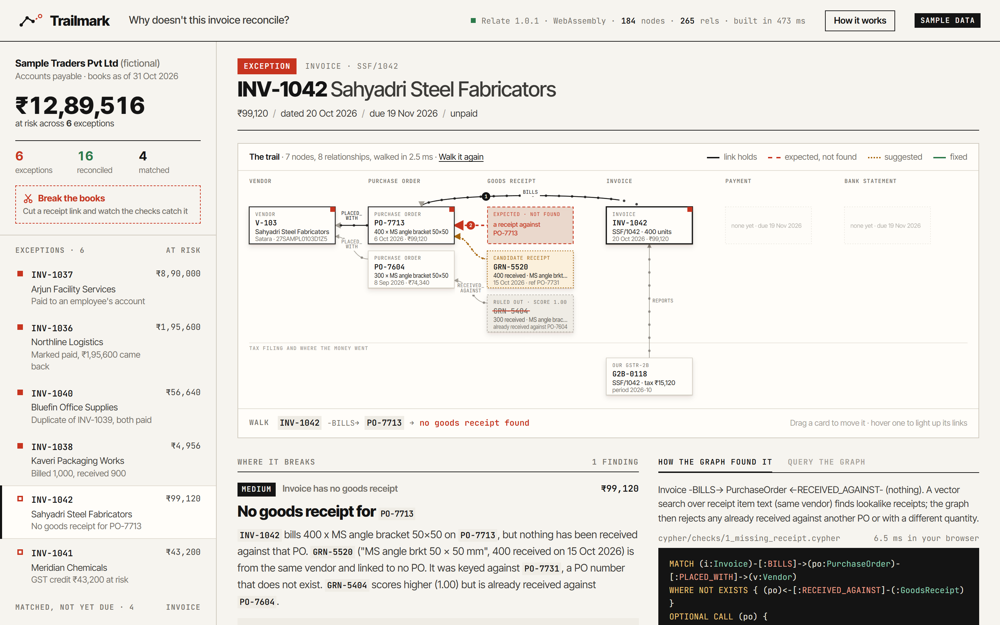
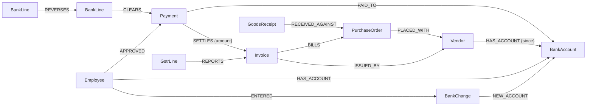
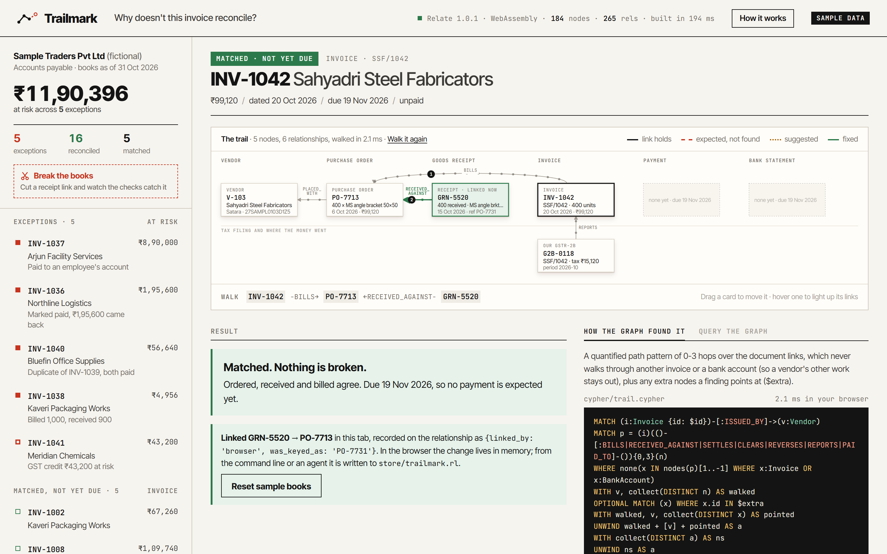

# Trailmark

**Why doesn't this invoice reconcile?** Trailmark follows an invoice through the accounts-payable trail (purchase order, goods receipt, invoice, payment, bank line, our GSTR-2B) as a [Relate](https://github.com/relatedb/relate) graph. It points at the exact link that is broken and shows the path that proves it.

[**Live demo**](https://automationbot24x7.github.io/trailmark/) (runs in your browser, nothing to install) · Python, CLI and AI-agent tools below



> **Sample data.** Every vendor, person, GSTIN, bank account and amount in this repo is invented. GSTINs carry `SAMPL` in the PAN slot and IFSC codes start with `SMPL`, so nothing can be mistaken for a real registration or account.

## Use case

At month end, an accounts-payable team ties out every invoice: was it ordered, was it received, was it paid, did the money really leave the bank, did the supplier report it for GST? Each answer sits in a different ledger. When something does not tie, someone opens five spreadsheets and follows the trail by hand.

The trail is a graph, and the hard breaks are only visible when you can walk it:

| # | Break | What the graph has to do | Sample |
|---|---|---|---|
| 1 | **Invoice has no goods receipt**, but the receipt exists, keyed against a PO number that does not exist | find the gap on `Invoice → PO ← Receipt`, then **vector search** over receipt item text (same vendor) for lookalikes, and let the graph reject the ones already received against another PO or with a different quantity | `INV-1042` |
| 2 | **Billed more than was received** | sum **many receipts and many invoices** that meet at one PO | `INV-1038` |
| 3 | **Marked paid, but the money came back** | one payment settles **three invoices**, leaves the bank as **two debits**, and one debit is **reversed**. The reversal chain is a quantified path pattern | `INV-1036` |
| 4 | **Same invoice paid twice** | two invoice nodes with one vendor, one normalised number (`BOS/889` = `BOS-889`) and one PO, each with its own payment and bank line | `INV-1040` |
| 5 | **Tax credit claimed, supplier never filed** | an invoice with no `REPORTS` link from a line of our GSTR-2B (the supplier never put it in their GSTR-1), while the same supplier's other invoices have one | `INV-1041` |
| 6 | **Large payment to a just-changed bank account that belongs to an employee** | every 1-3 hop path from the payment to any employee, over five relationship types: who **approved** the payment, who **entered** the new bank details, who **owns** the receiving account | `INV-1037` |

The other 20 invoices reconcile, so the checks are quiet when nothing is wrong. The six findings put ₹12,89,516 at risk.

## What connects to what



184 nodes and 265 relationships. The builder infers the links from flat CSV ledgers using the keys an accountant would use: PO number, bank reference (UTR), GSTIN plus invoice number. See [`cypher/link.cypher`](cypher/link.cypher). A receipt counts against a PO only if the PO number it was keyed with exists, which is how scenario 1 arises.

Item descriptions on purchase orders and receipts also carry a small text vector (`item_vec`): hashed character trigrams, 64 numbers, computed in [`trailmark/graph.py`](trailmark/graph.py) with no model and no network. It is enough to see that stores' "MS angle brkt 50 x 50 mm" is the PO's "MS angle bracket 50x50" (similarity 0.80), while an identical description (1.00) on a receipt already received against another PO is ruled out by the graph.

## How it uses Relate

- **Mode: single file**, `store/trailmark.rl`.
- **Why this mode:** one period's books as one file is a unit finance people already work with. You can attach it, archive it, or hand it to an auditor. The same file is opened by the embedded Python library (the app and agent tools), by Relate's own CLI, and by `relate serve` for MCP and Bolt. Readers open it `read_only`, so an agent can explore the books but cannot change them. The one write path is a single guarded statement.
- **What the graph models:** the accounts-payable document trail above, plus the people and bank accounts around the money.

Relate features this project leans on:

| Feature | Where |
|---|---|
| Embedded Python library, no server | [`trailmark/graph.py`](trailmark/graph.py) builds and opens the store in-process |
| Single-file `.rl` store, `read_only` opens | `store/trailmark.rl`; every read in the CLI and agent server |
| Uniqueness constraints, vector index | [`cypher/schema.cypher`](cypher/schema.cypher) |
| `SEARCH … VECTOR INDEX … WHERE … SCORE AS` inside an `OPTIONAL CALL` subquery, then graph filters | [check 1](cypher/checks/1_missing_receipt.cypher): vector search proposes, the graph disposes |
| Quantified path patterns `((…)-[…]-(…)){1,3}` | [check 3](cypher/checks/3_payment_returned.cypher), [check 6](cypher/checks/6_new_bank_account.cypher), [the trail](cypher/trail.cypher) |
| `EXISTS {}` subqueries, list comprehension, `reduce`, `duration.inDays` | all [checks](cypher/checks/) |
| WebAssembly build in the browser | [`web/`](web/): the page rebuilds the graph in the tab and runs the **same `.cypher` files** |
| MCP | [`trailmark/mcp.py`](trailmark/mcp.py) (domain tools) and `relate serve --mcp stdio --read-only` (raw Cypher), both in [`.mcp.json`](.mcp.json) |
| Agent-friendly results | the agent's `read_cypher` caps rows at 100 with an explicit `truncated` flag; the engine's own error text comes back so the agent can fix its query |

## Setup and run

You need **Python 3.10 or newer** and git. Tested on Windows, macOS and Linux ([CI](.github/workflows/ci.yml)).

```bash
git clone https://github.com/Automationbot24x7/trailmark
cd trailmark
python -m venv .venv
```

Activate the environment. On Windows:

```bash
.venv\Scripts\activate
```

On macOS or Linux:

```bash
source .venv/bin/activate
```

Then:

```bash
pip install -r requirements.txt     # just relate-db, Relate's Python package
python -m trailmark scan            # every exception in the sample books
python -m trailmark explain INV-1042
python -m trailmark view            # the graph in your browser, on http://127.0.0.1:8765/web/
```

`scan` prints:

```
  Trailmark  accounts payable as of 2026-10-31   SAMPLE DATA - all names and numbers are invented
  ──────────────────────────────────────────────────────────────────────────────
  26 invoices   16 reconciled   4 matched, not yet due   6 exceptions   ₹12,89,516 at risk
  ──────────────────────────────────────────────────────────────────────────────
  ● INV-1037   Large payment to a just-changed bank account    ₹8,90,000
      Paid to an employee's account
  ● INV-1036   Payment came back from the bank                 ₹1,95,600
      Marked paid, ₹1,95,600 came back
  ● INV-1040   Same invoice paid twice                           ₹56,640
      Duplicate of INV-1039, both paid
  ● INV-1038   Billed more than was received                      ₹4,956
      Billed 1,000, received 900
  ● INV-1042   Invoice has no goods receipt                      ₹99,120
      No goods receipt for PO-7713
  ● INV-1041   Tax credit claimed, supplier never filed          ₹43,200
      GST credit ₹43,200 at risk
```

Fix the one break the graph can repair, then put the books back:

```bash
python -m trailmark link GRN-5520 PO-7713 --note "PO digits swapped at stores"   # INV-1042 is now matched
python -m trailmark build                                                       # rebuild store/trailmark.rl from the CSVs
```

Other commands: `python -m trailmark cypher "MATCH (v:Vendor) RETURN v.name"` (read-only query), `python -m trailmark export` (refresh the browser copy), `python -m unittest -v` (seven end-to-end tests).

**Your own ledgers:** replace the CSVs in `data/sample/` with your own exports, keeping the column headers, then run `python -m trailmark build`. Each file's columns are listed in its header row; `data/generate_sample.py` shows how the sample was made.

### With the Relate CLI

The store is a plain Relate database. With the [Relate CLI](https://github.com/relatedb/relate/releases/latest) installed:

```bash
relate --read-only -d store/trailmark.rl "MATCH path = SHORTEST 1 (e:Employee {id: 'E-06'})-[*]-(v:Vendor {id: 'V-108'}) RETURN [n IN nodes(path) | n.id] AS hops"
```

That returns `["E-06","BA-8865","V-108"]`: the AP clerk's salary account is the vendor's new bank account.

## Use it from an AI agent (MCP)

`python -m trailmark mcp` is an MCP server on stdio with five tools:

| Tool | What it does |
|---|---|
| `scan_exceptions` | every finding, with plain-English detail, amount at risk, evidence nodes and suggested fix |
| `explain_invoice` | one invoice's status, findings and trail (nodes with one-line summaries, relationships) |
| `link_receipt` | the one write: links an unlinked receipt to a same-vendor PO, recording `linked_by`, `note` and `was_keyed_as` |
| `read_cypher` | read-only Cypher, at most 100 rows plus a `truncated` flag |
| `get_schema` | labels, relationship types and what they mean in accounts-payable terms |

A real `link_receipt` call (run on a copy of the store) and what came back:

```json
{"name": "link_receipt",
 "arguments": {"grn_id": "GRN-5520", "po_id": "PO-7713",
               "note": "Stores keyed PO-7731; same vendor, item and quantity as PO-7713"}}
```

```json
{
  "ok": true,
  "grn": "GRN-5520",
  "po": "PO-7713",
  "was_keyed_as": "PO-7731",
  "linked_by": "agent (mcp)",
  "invoices_now": [{"invoice": "INV-1042", "status": "matched", "remaining_findings": []}],
  "undo": "python -m trailmark build  (rebuilds the store from the sample CSVs)"
}
```

In the browser the same fix is one button, and the trail turns green:



[`.mcp.json`](.mcp.json) registers it (run your agent from the repo folder with the virtual environment active), alongside Relate's own `relate serve --mcp stdio --read-only` for raw access. [`AGENTS.md`](AGENTS.md) has the instructions and the questions used in the demo. Running `relate skill install` also teaches coding agents Relate's Cypher dialect.

## Why a graph

Check 6 asks: which of our own people are within three hops of this payment, and how? In Cypher, that is one pattern over a list of relationship types:

```cypher
MATCH path = (p:Payment {id: 'PAY-3410'})
             ((a)-[:PAID_TO|HAS_ACCOUNT|NEW_ACCOUNT|ENTERED|APPROVED]-(b)){1,3}
             (e:Employee)
RETURN e.name, [r IN relationships(path) | type(r)] AS route
```

In SQL, every route is its own join, and every new kind of link is another `UNION` arm:

```sql
SELECT e.name, 'approved the payment'       FROM payments p JOIN employees e          ON e.id = p.approved_by           WHERE p.id = 'PAY-3410'
UNION ALL
SELECT e.name, 'owns the receiving account' FROM payments p JOIN employee_accounts ea ON ea.account_id = p.account_id
                                            JOIN employees e          ON e.id = ea.employee_id          WHERE p.id = 'PAY-3410'
UNION ALL
SELECT e.name, 'entered the new account'    FROM payments p JOIN bank_changes bc      ON bc.new_account_id = p.account_id
                                            JOIN employees e          ON e.id = bc.entered_by           WHERE p.id = 'PAY-3410'
UNION ALL
SELECT e.name, 'approved the bank change'   FROM payments p JOIN bank_changes bc      ON bc.new_account_id = p.account_id
                                            JOIN employees e          ON e.id = bc.approved_by          WHERE p.id = 'PAY-3410';
```

The Cypher returns all of these, plus a fifth route nobody wrote a join for: from the payment to the clerk who approved it, to the bank change that clerk entered, to the AP lead who approved that change. The same holds for the trail itself: [`cypher/trail.cypher`](cypher/trail.cypher) is one 0-3 hop pattern that never walks *through* another invoice or bank account, so it pulls exactly one invoice's documents, however many payments, debits and returns there are.

## Where the data lives

| Path | What |
|---|---|
| `store/trailmark.rl` | **the persistent Relate store** (single file, about 300 KB). Inspect it with `relate info -d store/trailmark.rl` |
| `data/sample/*.csv` | the 13 sample ledgers it is built from (`python data/generate_sample.py` regenerates them) |
| `cypher/` | schema, linking rules, the six checks, the trail query and the one write, all as plain `.cypher` files |
| `web/data/graph.json` | an export of the store for the browser. The WebAssembly build runs in memory and cannot open a `.rl` file, so the page rebuilds the same graph from this export |

## Project layout

```
trailmark/        Python package: graph.py (build/open), checks.py, render.py, mcp.py, export.py, view.py, __main__.py (CLI)
cypher/           every query the app runs, shared by the CLI, the agent server and the browser
web/              the browser view (plain HTML/CSS/JS) and the vendored Relate WebAssembly engine
data/             sample ledgers and their generator
store/            the Relate store
tests/            end-to-end tests (standard library only)
```

## Credits and disclosure

- [Relate](https://github.com/relatedb/relate) by Neo4j (Apache-2.0): `relate-db` from PyPI, and the unmodified `@relate/relate-wasm` 1.0.1 package vendored in [`web/vendor/relate-wasm/`](web/vendor/relate-wasm/NOTICE.md).
- Fonts: Inter Tight and JetBrains Mono from Google Fonts.
- Everything else was written for this hackathon, with help from an AI coding assistant (described in the Devpost submission).

## License

[MIT](LICENSE).
